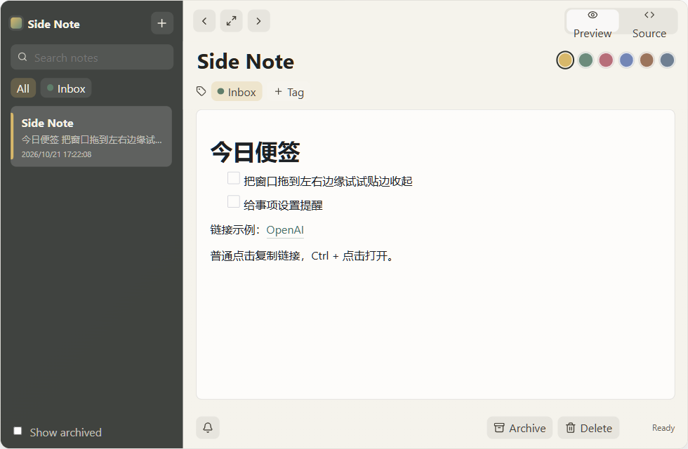

# Side Note

Side Note is a dockable desktop sticky note for quick thoughts, links, and small tasks. Keep it tucked against the edge of your screen, then bring it forward when you need it.



## Features

- Dock the window to the left or right edge of the screen.
- Write notes in a rendered Markdown editor or edit Markdown source directly.
- Search notes and organize them with tags and colors.
- Set reminders for notes and tasks.
- Archive a whole note or selected text, then restore it later.
- Import plain text files into a read-only, paged reading view.
- Keep notes in a local SQLite database. Side Note does not require an account or cloud sync.

## Download

Tagged releases publish a portable Windows x64 executable on the [GitHub Releases page](https://github.com/donnieYeh/side_note/releases). Download the latest release asset and run the `.exe`; no installer is required.

### Supported platform

Windows x64 is the only platform with a published build. macOS and Linux builds are not currently available.

## Quick start

1. Download and run the latest Windows x64 executable from [Releases](https://github.com/donnieYeh/side_note/releases).
2. Select **+** to create a note, then type in the editor. Use **Preview** for formatted Markdown or **Source** for Markdown text.
3. Use the arrow buttons in the toolbar to dock Side Note to the left or right edge of the screen.
4. Select the bell button to add a reminder. Select **Archive** to move a note out of the active list.

Notes are stored on this computer at `%APPDATA%\com.local.sidenote\side-note.sqlite3`.

## Roadmap

These are tentative priorities and may change:

- Improve note backup and export options.
- Add more keyboard-first workflows.
- Explore macOS and Linux support, including alternatives to the current Windows-specific docking behavior.

## Contributing

Bug reports, feature requests, and focused pull requests are welcome. See [CONTRIBUTING.md](CONTRIBUTING.md) for setup and submission guidance.

## Development

### Prerequisites

- Node.js LTS
- Rust stable with the MSVC toolchain
- Microsoft C++ Build Tools and WebView2 on Windows

See the [Tauri v2 prerequisites](https://v2.tauri.app/start/prerequisites/) for installation details.

### Run the app

```powershell
npm ci
npm run tauri:dev
```

`tauri:dev` starts the Vite development server and the desktop app together. To stop only this project's development processes, run:

```powershell
npm run dev:stop
```

### Build

```powershell
npm run tauri:build
```

This builds the frontend and produces a standalone executable at `src-tauri/target/release/side-note.exe`. To create installer packages instead, run the opt-in command:

```powershell
npm run tauri:bundle
```

For regular development, use `npm run tauri:dev` so the development server starts automatically. A raw `cargo run --release` expects an existing `dist/` and does not start Vite; run `npm run build` first, or use `npm run tauri:build` for the full release build sequence.

## Troubleshooting

Side Note writes diagnostic logs to:

```text
%APPDATA%\com.local.sidenote\logs\side-note.log
```

To enable debug logging, close the app and start it from PowerShell:

```powershell
$env:SIDE_NOTE_LOG = "debug"
& "C:\path\to\side-note.exe"
```

For a useful bug report, include the Windows version, display scaling, number of monitors, mouse or touchpad, dock side, and whether reminders were scheduled. Attach the log when it contains relevant details, after checking it for personal information.

## License

Side Note is licensed under the MIT License. See [LICENSE](LICENSE).
